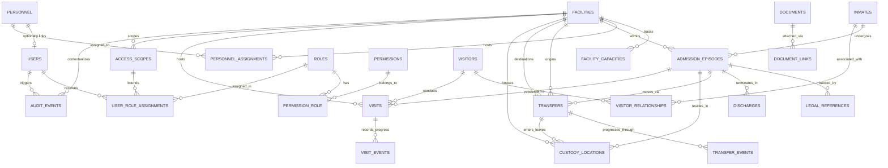

# Uganda Prisons Service — Prison Management System (PMS)
## Database Architecture & Design Specification (Phase B1)

**Document Status:** Working Technical Specification & Schema Reference  
**Application:** Uganda Prisons Service PMS (Laravel 13 on PHP 8.5, MySQL / MariaDB)  
**Schema Version:** Phase B1 Normalized Schema  
**Database Name:** `ups_prison_management`  

---

## 1. Executive Summary & Design Principles

The Uganda Prisons Service Prison Management System database schema is designed according to relational third-normal-form (3NF) principles with strict referential integrity, historical preservation, immutability of legal/audit actions, and separation of physical identity from custodial episodes and administrative user credentials.

### Key Architectural Tenets

1. **Surrogate Primary Keys with Independent Business Identifiers:**
   - Every table uses an auto-incrementing 64-bit integer (`id`) as its internal surrogate primary key.
   - Public and business identifiers (e.g. `prisoner_number`, `staff_number`, `code`, `reference`, `account_ref`) are stored in distinct, indexed, and uniquely constrained columns.
   - Business numbering rules for UPS remain configurable and flagged for official stakeholder confirmation.

2. **Inmate Identity vs. Admission Episode Separation:**
   - An individual (`inmates`) has an immutable physical identity record (`identity_ref`, biometrics/names/demographics).
   - Each incarceration period is recorded as an `admission_episodes` record. An inmate can have multiple lifetime admission episodes (e.g. readmission).
   - Active status is enforced via a unique virtual generated column (`open_inmate_id = CASE WHEN closed_at IS NULL THEN inmate_id ELSE NULL END`), mathematically preventing overlapping active admissions.

3. **Separation of Personnel Records from System Login Accounts:**
   - `personnel` contains official service member records (rank, department, appointment date, next of kin).
   - `users` stores application credentials, session state, and security status.
   - A user account may optionally link 1:1 to a personnel record (`users.personnel_id`), but personnel creation never automatically provisions user access.

4. **Immutable History & State Machines:**
   - Neither transfers nor visits overwrite their historical steps; they append sequence-numbered transition events (`transfer_events`, `visit_events`).
   - Facility reassignments require formal lifecycle progression (`transfers` -> `transfer_events` -> `custody_locations`).
   - Audit logs (`audit_events`) are strictly append-only, capturing actor, action, timestamp, correlation reference, and structured JSON change deltas.

5. **Exclusive Polymorphic Document Linking:**
   - Files and documents are indexed in `documents` with storage metadata and SHA-256 hashes.
   - `document_links` attaches documents to exactly one domain entity (inmate, admission, legal reference, transfer, etc.) enforced by a database CHECK constraint.

---

## 2. Entity-Relationship Diagram (ERD)

---

## 3. Module Schema Specifications

### 3.1 Facilities Management Module

#### `facilities`
Stores canonical correctional institutions.

| Column | Type | Constraints | Description |
|---|---|---|---|
| `id` | BIGINT UNSIGNED | PK, AUTO_INCREMENT | Internal unique surrogate ID |
| `code` | VARCHAR(64) | UNIQUE, NOT NULL | Facility code (e.g. `DEMO-FAC-001`) |
| `name` | VARCHAR(255) | NOT NULL, INDEX(name, status) | Official facility name |
| `type` | VARCHAR(255) | NULL | Security type (Maximum, Medium, Remand) |
| `region` | VARCHAR(255) | NULL | Administrative region (Central, Eastern, etc.) |
| `district` | VARCHAR(255) | NULL | Host district |
| `location_description` | TEXT | NULL | Physical address and descriptive location |
| `status` | VARCHAR(64) | NOT NULL, DEFAULT 'Inactive' | Active, Inactive, Renovation, Decommissioned |
| `established_on` | DATE | NULL | Date facility was commissioned |
| `notes` | TEXT | NULL | General operational remarks |
| `created_at` / `updated_at` | TIMESTAMP | NULL | Standard Laravel timestamps |

#### `facility_capacities`
Historical capacity records preventing unverified or retroactive overwrites.

| Column | Type | Constraints | Description |
|---|---|---|---|
| `id` | BIGINT UNSIGNED | PK, AUTO_INCREMENT | Internal capacity entry ID |
| `facility_id` | BIGINT UNSIGNED | FK -> facilities(id), RESTRICT | Associated facility |
| `capacity` | INT UNSIGNED | NULL, CHECK(capacity >= 0) | Authorized inmate capacity |
| `effective_on` | DATE | NOT NULL | Date capacity became authoritative |
| `source_reference` | VARCHAR(255) | NULL | Official Gazette or inspection notice ref |
| `notes` | TEXT | NULL | Methodology / structural notes |
| `recorded_by` | BIGINT UNSIGNED | FK -> users(id), NULL | Account recording the change |
| `created_at` / `updated_at` | TIMESTAMP | NULL | Standard timestamps |
| *Composite Unique* | UNIQUE(`facility_id`, `effective_on`) | Ensures at most one capacity per day |

---

### 3.2 Personnel & Assignments Module

#### `personnel`
Authoritative service records of uniformed and civilian staff.

| Column | Type | Constraints | Description |
|---|---|---|---|
| `id` | BIGINT UNSIGNED | PK, AUTO_INCREMENT | Internal personnel ID |
| `staff_number` | VARCHAR(64) | UNIQUE, NOT NULL | Official service number |
| `first_name` | VARCHAR(255) | NOT NULL, INDEX(last, first) | Given name |
| `middle_name` | VARCHAR(255) | NULL | Middle or other names |
| `last_name` | VARCHAR(255) | NOT NULL | Surname |
| `gender` | VARCHAR(64) | NULL | Gender |
| `date_of_birth` | DATE | NULL | Date of birth |
| `nationality` | VARCHAR(255) | NULL | Nationality |
| `rank` | VARCHAR(255) | NULL | Rank (e.g. Commissioner, Superintendent, Warder) |
| `department` | VARCHAR(255) | NULL, INDEX(status, dept) | Department (Custody, Operations, Medical) |
| `employment_status` | VARCHAR(64) | NOT NULL, DEFAULT 'Inactive' | Active, Inactive, Suspended, Retired |
| `appointed_on` | DATE | NULL | Date enlisted into the service |
| `email` | VARCHAR(255) | NULL | Official contact email |
| `phone` | VARCHAR(64) | NULL | Primary telephone number |
| `kin_name` | VARCHAR(255) | NULL | Next of kin contact name |
| `kin_contact` | VARCHAR(255) | NULL | Next of kin phone/address |
| `notes` | TEXT | NULL | Personnel service file notes |

#### `personnel_assignments`
Tracks officer duty postings and history across facilities.

| Column | Type | Constraints | Description |
|---|---|---|---|
| `id` | BIGINT UNSIGNED | PK, AUTO_INCREMENT | Assignment entry ID |
| `assignment_ref` | VARCHAR(64) | UNIQUE, NOT NULL | Unique assignment identifier |
| `personnel_id` | BIGINT UNSIGNED | FK -> personnel(id), RESTRICT | Assigned officer |
| `facility_id` | BIGINT UNSIGNED | FK -> facilities(id), RESTRICT | Station facility |
| `duty_title` | VARCHAR(255) | NULL | Specific role (e.g. Duty Officer, Records Officer) |
| `reason` | TEXT | NULL | Reason for transfer / assignment order |
| `start_date` | DATE | NOT NULL | Posting commencement date |
| `end_date` | DATE | NULL, CHECK(end >= start) | Posting conclusion date (NULL if current) |
| `status` | VARCHAR(64) | DEFAULT 'Draft' | Active, Completed, Cancelled, Draft |
| `authority_reference` | VARCHAR(255) | NULL | Official deployment signal reference |
| `recorded_by` | BIGINT UNSIGNED | FK -> users(id), NULL | System user logging the posting |

---

### 3.3 User Access, Roles, Permissions & Scopes Module

#### `users` (Extended)
| Column | Type | Constraints | Description |
|---|---|---|---|
| `id` | BIGINT UNSIGNED | PK, AUTO_INCREMENT | User ID |
| `name` | VARCHAR(255) | NOT NULL | Full display name |
| `email` | VARCHAR(255) | UNIQUE, NOT NULL | Authentication login email |
| `password` | VARCHAR(255) | NOT NULL | Bcrypt / Argon2 hashed password |
| `account_ref` | VARCHAR(64) | UNIQUE, NULL | Account code (e.g. `DEMO-USER-001`) |
| `personnel_id` | BIGINT UNSIGNED | UNIQUE, FK -> personnel(id) | Linked service personnel record |
| `status` | VARCHAR(64) | DEFAULT 'Disabled' | Active, Suspended, Disabled, Pending |
| `last_login_at` | DATETIME | NULL | Timestamp of last authenticated session |

#### `roles`, `permissions`, `permission_role`
Catalog of administrative and operational permissions.
- `roles`: `id`, `slug` (UNIQUE), `name`, `description`.
- `permissions`: `id`, `slug` (UNIQUE), `name`, `module`.
- `permission_role`: Composite PK(`role_id`, `permission_id`).

#### `access_scopes` & `user_role_assignments`
Granular authorization boundary enforcement.
- `access_scopes`: Distinguishes `National` (across all facilities) and `Facility` (scoped to a specific facility). Enforces `CHECK((kind='National' AND facility_id IS NULL) OR (kind='Facility' AND facility_id IS NOT NULL))`.
- `user_role_assignments`: Grants a role within an access scope for a defined time window. Virtual column `open_scope_id` prevents duplicate active concurrent role assignments.

---

### 3.4 Inmate Management, Custody Episodes & Legal References

#### `inmates`
Immutable identity and demographic profile of an incarcerated person.

| Column | Type | Constraints | Description |
|---|---|---|---|
| `id` | BIGINT UNSIGNED | PK, AUTO_INCREMENT | Internal inmate surrogate ID |
| `identity_ref` | VARCHAR(64) | UNIQUE, NOT NULL | Inmate master reference |
| `prisoner_number` | VARCHAR(64) | UNIQUE, NULL | Official prisoner number (when assigned) |
| `first_name` | VARCHAR(255) | NOT NULL | Given name |
| `middle_name` | VARCHAR(255) | NULL | Middle name |
| `last_name` | VARCHAR(255) | NOT NULL | Surname |
| `gender` | VARCHAR(64) | NULL | Gender |
| `date_of_birth` | DATE | NULL | Date of birth |
| `nationality` | VARCHAR(255) | NULL | Country of origin |
| `district` | VARCHAR(255) | NULL | Home district |
| `id_type` | VARCHAR(64) | NULL | National ID (NIN), Passport, Refugee Card |
| `id_number` | VARCHAR(255) | NULL | Identification number (masked in UI) |
| `kin_name` | VARCHAR(255) | NULL | Next of kin name |
| `kin_relationship` | VARCHAR(255) | NULL | Relationship to inmate |
| `kin_contact` | VARCHAR(255) | NULL | Next of kin phone/contact |

#### `admission_episodes`
Records each distinct detention episode.

| Column | Type | Constraints | Description |
|---|---|---|---|
| `id` | BIGINT UNSIGNED | PK, AUTO_INCREMENT | Episode surrogate ID |
| `admission_ref` | VARCHAR(64) | UNIQUE, NOT NULL | Unique admission reference |
| `inmate_id` | BIGINT UNSIGNED | FK -> inmates(id), RESTRICT | Linked inmate record |
| `admitting_facility_id` | BIGINT UNSIGNED | FK -> facilities(id), RESTRICT | Receiving initial facility |
| `admitted_at` | DATETIME | NOT NULL | Formal booking timestamp |
| `closed_at` | DATETIME | NULL, CHECK(closed >= admitted) | Discharge / episode end timestamp |
| `state` | VARCHAR(64) | DEFAULT 'Draft' | Open, Closed, Draft, Transferred |
| `classification` | VARCHAR(64) | NULL | Convicted, Remand, Civil, Debtor |
| `legal_basis` | TEXT | NULL | Committal warrant or remand order text |
| `open_inmate_id` | BIGINT UNSIGNED | STORED UNIQUE | Virtual column ensuring <= 1 active episode |

#### `legal_references` & `discharges`
- `legal_references`: Court warrants, committal documents, case numbers, next court dates, and recorded sentences.
- `discharges`: Formal release orders requiring explicit legal reference, authorization trail (`requested_by`, `authorized_by`, `executed_by`), and sequence timestamps.

---

### 3.5 Inmate Transfers Module

#### `transfers`
Manages inter-facility inmate movements.

| Column | Type | Constraints | Description |
|---|---|---|---|
| `id` | BIGINT UNSIGNED | PK, AUTO_INCREMENT | Internal transfer ID |
| `transfer_ref` | VARCHAR(64) | UNIQUE, NOT NULL | Transfer document reference |
| `admission_episode_id` | BIGINT UNSIGNED | FK -> admission_episodes(id) | Active admission being moved |
| `origin_facility_id` | BIGINT UNSIGNED | FK -> facilities(id) | Dispatching facility |
| `destination_facility_id` | BIGINT UNSIGNED | FK -> facilities(id) | Receiving facility |
| `requesting_facility_id` | BIGINT UNSIGNED | FK -> facilities(id) | Initiating facility |
| `state` | VARCHAR(64) | DEFAULT 'Draft' | Draft, Pending, Approved, In Transit, Completed |
| `priority` | VARCHAR(64) | DEFAULT 'Routine' | Routine, High, Medical, Security |
| `reason` | TEXT | NULL | Medical, court attendance, overcrowding |
| `requested_at` | DATETIME | NOT NULL | Request timestamp |
| `dispatched_at` | DATETIME | NULL | Physical departure timestamp |
| `received_at` | DATETIME | NULL | Physical arrival timestamp |
| *Constraints* | CHECK(origin != destination), CHECK(received >= dispatched >= requested) |

#### `transfer_events` & `custody_locations`
- `transfer_events`: Immutable audit trail of every status transition in a transfer's lifecycle with sequence number.
- `custody_locations`: Precise timeline of an inmate's physical location at any point in time. Virtual unique column `open_admission_id` enforces exactly one current location for an active inmate.

---

### 3.6 Visitor Management Module

- `visitors`: Identity details of approved/registered visitors, document types, phone, and review status.
- `visitor_relationships`: M:N relationship linking visitors to inmates with declared affiliation (family, legal counsel, consular, spiritual).
- `visits`: Scheduled or completed visitation events, checking in/out times, and visit state (`Requested`, `Scheduled`, `Checked In`, `Completed`, `Cancelled`, `Denied`).
- `visit_events`: Audit trail for visitation state changes.

---

### 3.7 Supporting Documents & Audit Module

- `documents`: File catalog with hash verification (`sha256`), mime types, sizes, and retention policies.
- `document_links`: Polymorphic linker attaching a document to exactly one parent record via CHECK constraint.
- `audit_events`: Tamper-evident, append-only security log containing actor, facility, action, outcome, target resource, and JSON state transitions (`changes`).

---

## 4. Unresolved UPS Stakeholder Validation Items

The following items are architecturally isolated and explicitly marked for verification prior to production rollout:

1. **Prisoner Number Generation:** The system does not assume or synthesize an official UPS numbering formula. Official conventions must be validated by UPS ICT / Records leadership.
2. **Sentencing Computation & Remission:** Release calculations are treated as human-validated legal inputs; the system never computes binding legal release dates autonomously.
3. **Escort Security Details:** Operational vehicle registrations, escort officer rosters, and route details are kept in restricted operational logs and not exposed on general transit previews.
4. **Offline Synchronization Policy:** Custodial operations (admissions, transfers, discharges) must never be silently finalized offline without authorized online verification.
